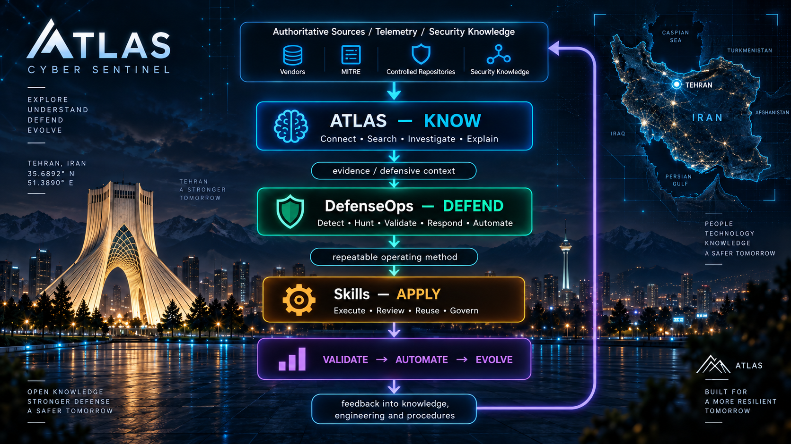
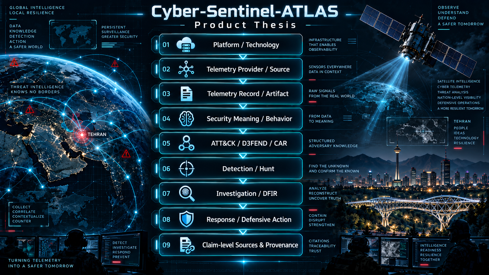
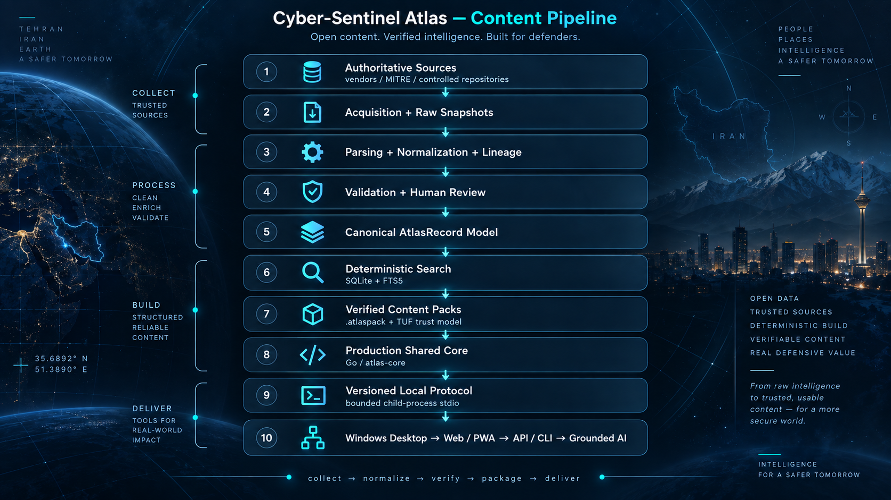

<p align="center">
  
</p>

<h1 align="center">Cyber-Sentinel ATLAS</h1>
<p align="center"><strong>Provenance-First Cyber Defense Knowledge & Investigation Platform</strong></p>
<p align="center">KNOW • SEARCH • INVESTIGATE • EXPLAIN • VERIFY</p>

<p align="center">
  <a href="docs/current-status.md"></a>
  <a href="docs/releases/phase-5.10-public-preview-readiness.md"></a>
  
  
  
  
</p>

ATLAS is the **KNOW** layer of the Cyber-Sentinel ecosystem: an offline-first analyst workbench and verified knowledge platform for connecting telemetry, canonical security records, adversary behavior, investigation pivots, relationships, defensive context, and claim-level provenance.

> **Core question:** **What do we know about what we are seeing — and what evidence supports it?**

ATLAS is designed for SOC analysts, incident responders, threat hunters, DFIR practitioners, detection engineers, security architects, and restricted/high-assurance environments that need investigation context to remain **deterministic, attributable, reviewable, offline-capable, and operationally safe**.

> **First Preview engineering readiness:** READY
>
> **Release state:** Pre-preview / unreleased
>
> **Repository visibility:** Public
>
> **Public Preview state:** BLOCKED / fail-closed
>
> **No technical claim without provenance.**

## Current State

ATLAS deliberately separates **engineering evidence**, **candidate validation**, **Product Owner acceptance**, and **public-release authority**.

| Boundary | Verified state |
| --- | --- |
| Public `main` release authority | Engineering-ready First Preview; Public Preview remains fail-closed |
| Microsoft-Windows-Security-Auditing | **423/423** encyclopedia-grade; `0` remaining |
| Windows Security Log UWS review benchmark | **422/422** listed identities; benchmark only, not semantic authority |
| Sysmon 15.22 | **30/30** encyclopedia-grade; `0` remaining |
| PowerShell Operational | **43/43** in the validated MVP-2 candidate workstream |
| Integrated MVP-2 runtime corpus | **502/502** clean-Windows runtime acceptance on the current candidate |
| Windows Desktop candidate | Exact-source Windows build + clean-Windows automated acceptance **PASS** |
| Product Owner interactive review | **PENDING** for the current MVP-2 candidate |
| Global Windows denominator | Intentionally **not frozen** |
| Public Preview | **BLOCKED** until every mandatory release gate passes |

The PowerShell `43/43` and integrated `502/502` figures describe the validated MVP-2 candidate workstream. They are **not** a claim that the candidate has been promoted to public `main` or authorized as a public release.

The global Windows denominator remains intentionally undefined while additional mandatory telemetry families are brought under controlled family-specific coverage. ATLAS does not publish a misleading “all Windows Event IDs” percentage.

## Why ATLAS Exists

Security investigation knowledge is fragmented across operating systems, SIEMs, EDR/XDR platforms, cloud environments, container runtimes, vendor documentation, threat intelligence, detection repositories, DFIR references, standards, and analyst experience.

ATLAS creates a governed layer between those sources and the analyst. It does **not** collapse source authority, provenance, version context, or confidence boundaries merely to make retrieval convenient.

**No technical claim without provenance.**

<p align="center">
  
</p>

## Analyst Experience

The current MVP-2 direction is **search-first**: the primary page should answer the analyst quickly; deeper views provide supporting evidence and investigation structure.

```text
Search
  ↓
Quick Answer
  ↓
Record Detail + Fields
  ↓
Sources + Provenance
  ↓
Relationships / Mind Map
  ↓
Investigation Context
  ↓
ATLAS Entity guidance
```

The analyst surface is designed around:

- Event ID, provider, title, behavior, tool/executable, and ATT&CK-oriented lookup where governed content exists;
- concise Quick Answer before internal/canonical detail;
- version-aware fields and examples only when source-backed;
- explicit source/provenance views;
- bounded relationship and investigation graphs;
- evidence timeline and pivots;
- an ATLAS Entity that presents grounded context without exposing hidden chain-of-thought;
- advanced/raw internals separated from the primary investigation view.

## Core Product Capabilities

### Deterministic knowledge retrieval

- exact-before-lexical resolution;
- SQLite + FTS5 production search core;
- canonical record and entity detail;
- explicit provider/product/version identity;
- bounded graph expansion;
- source and claim provenance.

### Verified offline knowledge

- `.atlaspack` verified content packs;
- TUF-based trust model;
- trusted-time and highest-seen rollback protection;
- immutable generations;
- health-gated activation;
- Last Known Good recovery;
- no mandatory cloud dependency for core investigation.

### Analyst investigation

- Search → Record → Provenance workflow;
- relationship and mind-map navigation;
- investigation pivots;
- telemetry field context;
- evidence-backed detection/hunt/DFIR context as content maturity allows;
- clean separation between facts, evidence, hypotheses, support/refute state, and confidence.

### Grounded AI direction

ATLAS is AI-ready but not AI-dependent. Deterministic retrieval and provenance remain authoritative. Optional AI assistance may summarize or reason over governed context, but model output does not silently become canonical truth.

## Coverage Model

ATLAS measures coverage by **controlled family-specific denominators**, not by arbitrary fixture counts.

| Family | Controlled coverage | Status |
| --- | ---: | --- |
| Microsoft-Windows-Security-Auditing / Security | `423/423` | **COMPLETE** |
| Sysmon 15.22 | `30/30` | **COMPLETE** |
| PowerShell Operational | `43/43` | **Validated MVP-2 candidate** |
| Windows Security Log UWS benchmark | `422/422` | **Review benchmark COMPLETE** |
| Global Windows | — | **Denominator not frozen** |

UWS is a controlled cross-provider review/Quick Detail benchmark only. Microsoft official documentation and controlled provider/channel/version evidence remain semantic authority for Windows content.

Authoritative public coverage references:

- [`content/encyclopedia/coverage-manifest.json`](content/encyclopedia/coverage-manifest.json)
- [`docs/windows-security-log-scope.md`](docs/windows-security-log-scope.md)
- [`docs/windows-sysmon-coverage-plan.md`](docs/windows-sysmon-coverage-plan.md)

## Architecture

<p align="center">
  
</p>

```text
Authoritative Sources
        ↓
Acquisition + Raw Snapshots
        ↓
Parsing + Normalization + Lineage
        ↓
Validation + Human Review
        ↓
Canonical AtlasRecord Model
        ↓
Deterministic Search (SQLite + FTS5)
        ↓
Verified Content Packs (.atlaspack + TUF)
        ↓
Production Shared Core (Go)
        ↓
Versioned Local Protocol
        ↓
Windows Desktop → Web/PWA → API/CLI → Grounded AI
```

### Accepted production boundary

| Area | Accepted boundary |
| --- | --- |
| Canonical schema | `1.0.0`, JSON Schema Draft 2020-12 |
| Canonical model | Exactly seven `AtlasRecord` families |
| Search | SQLite + FTS5, exact-before-lexical |
| Content trust | TUF verification + trusted-time + rollback protection |
| Shared Core | Go |
| Desktop host | Tauri 2.x |
| Desktop/Core IPC | bounded child-process stdio, `atlas-core/1.0.0` |
| Network posture | no default local HTTP/TCP/WebSocket listener |
| User-facing CLI direction | `atlas` |

## Security & Trust Posture

The First Preview intentionally keeps a narrow local attack surface:

- one main-window capability boundary;
- exactly seven exposed application commands;
- no generic frontend-controlled Shared Core bridge;
- CSP `connect-src 'none'`;
- no default application network listener;
- adjacent SHA-256-bound Shared Core sidecar;
- verified-pack trust and rollback semantics;
- no application-binary auto-update path in First Preview;
- fail-closed handling where trust, provenance, source, schema, or redistribution ambiguity is material.

These are engineering controls, not universal production authorization for every environment.

## Public / Private Source Boundary

The public repository contains independently authored engineering material, public-safe source metadata, canonical structures, validation evidence, and product code.

Raw restricted/private course material, copyrighted PDFs/posters, confidential Product Owner governance, credentials, private signing material, and uncontrolled production data are **not** public-repository content. Restricted references may inform independently authored knowledge only under explicit source-governance rules.

## Product Family

```text
ATLAS
│
├── Desktop
│   ├── Windows        ← current release-critical surface
│   ├── Linux
│   └── macOS
│
├── CLI
├── Web
├── PWA
├── API
└── Mobile
    ├── iOS
    └── Android
```

This is approved delivery scope, not a statement that every surface is released today. All surfaces must consume the same canonical/provenance contracts rather than creating competing sources of truth.

See [`docs/product-surfaces.md`](docs/product-surfaces.md).

## What ATLAS Is Not

ATLAS is not:

- an Event ID wiki;
- an ATT&CK browser clone;
- a SIEM-specific rule portal;
- an unvalidated detection dump;
- an opaque RAG chatbot;
- a replacement for environment-specific analyst judgment or production change control.

It is a **Cyber Defense Knowledge Graph + Analyst Workbench + Verified Offline Knowledge Platform**.

## Documentation

| Area | Authority |
| --- | --- |
| Documentation hub | [`docs/README.md`](docs/README.md) |
| Current verified status | [`docs/current-status.md`](docs/current-status.md) |
| Durable project state | [`docs/project-state.md`](docs/project-state.md) |
| Public roadmap | [`docs/roadmap.md`](docs/roadmap.md) |
| Product surfaces | [`docs/product-surfaces.md`](docs/product-surfaces.md) |
| Coverage plan | [`docs/windows-sysmon-coverage-plan.md`](docs/windows-sysmon-coverage-plan.md) |
| Public Preview readiness | [`docs/releases/phase-5.10-public-preview-readiness.md`](docs/releases/phase-5.10-public-preview-readiness.md) |
| Architecture decisions | [`docs/adr/`](docs/adr/) |
| Analyst UX | [`docs/ux/`](docs/ux/) |

Machine-readable coverage and release-state artifacts remain authoritative when prose and generated state ever diverge.

## Cyber-Sentinel Ecosystem

```text
ATLAS       — KNOW   → Connect • Search • Investigate • Explain
DefenseOps  — DEFEND → Detect • Hunt • Validate • Respond • Automate
Skills      — APPLY  → Execute • Review • Reuse • Govern
```

- [Cyber-Sentinel DefenseOps](https://github.com/cyber-sentinel/Cyber-Sentinel-DefenseOps)
- [Cyber-Sentinel Skills](https://github.com/cyber-sentinel/Cyber-Sentinel-Skills)
- [Cyber-Sentinel ecosystem landing page](https://github.com/cyber-sentinel)

## Release & Licensing Boundary

Public repository visibility does not imply a signed public release, GA status, redistribution permission, or universal production approval. No project `LICENSE` is currently published in this repository; public visibility alone does not grant reuse or redistribution rights.

---

<p align="center"><strong>Cyber-Sentinel ATLAS — KNOW with evidence.</strong></p>
<p align="center"><sub>Maintained by Ali RahimDabagh</sub></p>
